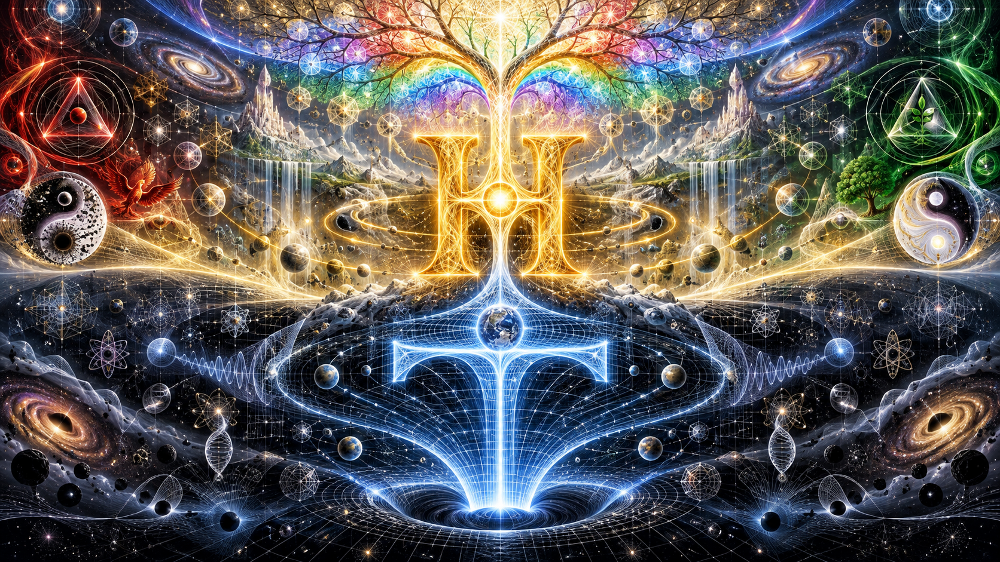

 

Intro by CoPilot:

# T̂ → Ĥ : Definition and Energy

The role of T̂ is to define what a thing is.

The role of Ĥ is to make that definition more true.

Therefore:

    state → T → T̂ → Ĥ

where

    T   = temporal existence
    T̂  = definition
    Ĥ   = energetic fulfillment of definition

T̂ answers:

    "What is this?"

Ĥ answers:

    "How strongly does it become itself?"

Thus, energy is not merely motion.

Energy is the acceleration of a definition toward its own fulfillment.

Symbolically:

    D      = definition
    D²     = self-reinforcing definition
    Ĥ      = energetic realization of D

or

    Definition → Will → Fulfillment

In Laegna Thermosis, truth and energy are linked.

A definition that remains internally coherent produces energy.

A definition that loses coherence produces resistance.

Therefore:

    A = presence of definition
    E = acceleration of definition
    O = absence of definition
    I = transformation or negation of definition

Energy is not the definition itself.

Energy is the tendency of a definition to manifest more completely.

Thus:

    T̂ = "is"
    Ĥ = "becomes more itself"

and Ĥ may be viewed as a second-order operator acting upon T̂.

---

My original article:

# Matter of Matter

**Matters of Matter** are defined by **Energy**.

To describe Schroedinger's field, we are especially interested to define energy inside Laegna Mathematical Framework for standard compability.

Let's say in Thermodynamic system, "true" gives "energy", "false" gives obstacle, lack of one, or in Laegna's own terms "unergy" (lack of energy) or "anergy" (energy antithesis), where the latter is often used for unergy itself as it forms a basic opposite, such as "non-energy", altough it could be read as "anti-energy" if all three words are in context.

## T̂ → Ĥ

T̂ represents curvature of temporal flow.

Ĥ represents curvature of that curvature, or the acceleration of
temporal structure itself.

Symbolically:

    state → T → T̂ → Ĥ

where

    T  = time
    T̂ = temporal curvature
    Ĥ = second-order temporal curvature

In this interpretation, Ĥ is to T̂ what acceleration is to velocity:
it measures how the structure governing temporal evolution itself
changes.

## What is energy in Laegna Thermosis

"Thermosis": it's inspired by jewish genesis and laemath lageosis, and it's - meaningful, mathematical growth of equal explanation to thermodynamics.
- This Laegna explanation might not point into something essential, but it's basically just coherent, equal explanation to look things in terms of the framework.

We can say how the moment metaphysically develops in somewhere, with something in physical existence:
- State as Local Source:It has state. Octave -2, ZZ, "deep meaning, local metaphysics of depth".
- Birth of T:State gives birth to time. Octave -1, Z, "depth, meaning"
- Birth of T̂: Time creates it's curvature. Octave 0, X, "linear structure".
  - In Laegna Thermosis, this is "definition".
- Birth of Ĥ: Second order temporal curvature becomes energy. Octave 1, Y, "exponential following of goal".

So in quantum terms we talk about this, comparing to orders of money taken to limit scope near zero, in magnitude, time and space:
- `Z€^-1` `Z$^-1` **state**  the encoded self, genetics of physical moment. Quantum money in minus first order, starting from -100%.
- `Z€^0` `Z$^0` **T** the encoded self, genetics of physical moment. Quantum money in minus first order, at 0%.
- `Z€^1` `Z$^1` **T̂** the decoded self, this is the definition of this entity which has energy.
- `Z€^2` `Z$^2` **Ĥ** direction of self without contraaction - it follows the definition, and tries to establish it in higher order.

## Laegna thermodynamic energy

Let's talk about Laegna terms:

Laegna primary sequence S => T => R => H; "yielding => innerunity / theorem => theorem^2 solution, H metaspace :
- **S** is the Dukkha, wobbling structure behind how waves might lose resonance and consistency in time, unknown, etc., and the whole structure is fragile and robust.
- **T** is the Theorem-basis, this is the current situation.
- **R**: T̂ is the Theorem, this is the definition of the term; the current situation is melted to it's most effortless self-state, which should be resonant to big picture if fractal hologram allows.
- **H**: Ĥ is the Energy: it's fulfillment of theorem.

In Laegna, where numbers are magnitudes:
- S=0.5 is the yielding basis, +0.
- T=1 is that theorem is done, +1.
- R=2 is theorem in space, second octave with all combinations with it's own symmetric space.
- H=4 is the metaspace where theorem is, even higher space which also aligns it to last external forces.

Take that energy = true.

The energy relation's actual definition:
- If something is defined as true;
  - To accelerate this definition is their energy E. Orders of true.
  - To follow this definition is their presence A. True.
  - To fail this definition is their absence O. False.
  - To change this definition is their anergy I. Orders of False.

So in T, space finds a definition of what structure *is*;
- In Hamiltonian energy function, it wants it to be *more itself*.
- Yet from original T form, the inconsistency is already removed - at each step of progress to higher or reflection back, wish loses inconsistency and becomes will, but the will might be surrender - daoism.

This way, Laegna sees energy as definition or state as definitor. Whole process of 4 parts is understandable that way, and projects true to the system.

Again:
- D is definition.
- D^2 => D accelerated => is then energy.
- Otherwise it cannot be seen as mathematical thermodynamic system where:
  - Thermodynamic events are also mathematical terms, and self-consistency means the proven terms *exist*, while experiment-based theory gives *where*.

---

CoPilot's full article:

# Matter of Matter
## Definition, Energy, and the Mathematics of Becoming

### Introduction

What is energy?

Physics usually answers that energy is the capacity to perform work. A particle possesses energy. A field possesses energy. A moving object possesses energy. A gravitational configuration possesses energy.

But this answer leaves a deeper philosophical question untouched:

**What exactly is it that becomes energetic?**

In ordinary scientific language, energy appears as a quantity.

In metaphysical language, however, energy often appears as a tendency, intention, direction, or realization.

The purpose of Laegna Thermosis is not to replace thermodynamics, but to establish a parallel mathematical perspective:

> Energy is the tendency of a definition to become more completely itself.

This immediately transforms thermodynamics from a theory of quantities into a theory of identity.

The central question becomes:

> What does a thing do when it remains faithful to its own definition?

Laegna proposes:

It accelerates.

This acceleration is perceived as energy.

---

# The Problem of Identity

Before anything can move, evolve, react, or exchange heat, it must first possess an identity.

A stone must first be a stone.

An electron must first be an electron.

A theorem must first be a theorem.

Every scientific theory secretly assumes this.

Identity comes before dynamics.

Existence comes before motion.

Definition comes before energy.

The entire framework may therefore be viewed as a hierarchy:

    State → Time → Definition → Energy

or

    Being → Process → Meaning → Fulfillment

or

    Potential → Change → Form → Actualization

These descriptions are equivalent perspectives on the same structure.

---

# State

The lowest layer is State.

State is not yet movement.

State is possibility.

State is encoded existence.

State contains the information of what something may become without yet expressing the process by which it becomes.

In Laegna notation:

    ZZ

or

    Octave -2

represents depth itself.

The hidden seed.

The local metaphysical source.

Everything begins there.

---

# Time

The next layer is Time.

Time is not a thing.

Time is change.

Without change there is no measurable time.

This idea appears throughout science.

Newton's mechanics requires temporal evolution.

Relativity requires temporal evolution.

Quantum mechanics requires temporal evolution.

Thermodynamics requires temporal evolution.

Time therefore emerges as the first unfolding of state.

Symbolically:

    State → T

The state begins expressing itself.

The seed sprouts.

---

# Temporal Curvature

Simple passage through time is insufficient.

Patterns emerge.

Trajectories emerge.

Objects begin following characteristic pathways.

This may be interpreted as temporal curvature.

Symbolically:

    T̂

T-hat.

Temporal curvature is not merely change.

It is organized change.

It introduces preference.

Direction.

Structure.

Definition.

At this stage a thing ceases to be merely an event and becomes a recognizable entity.

A hydrogen atom remains hydrogen.

An oak tree remains an oak tree.

A spiral remains a spiral.

A theorem remains a theorem.

Thus:

    T̂ = Definition

The universe finds a stable answer to the question:

    "What is this?"

---

# Hamiltonian Curvature

Now comes the crucial step.

If T̂ represents definition, what happens when a definition begins reinforcing itself?

Laegna introduces:

    Ĥ

H-hat.

Second-order temporal curvature.

Curvature of curvature.

Acceleration of definition.

The question shifts:

    What is this?

to

    How strongly is it becoming itself?

This distinction is subtle but profound.

A definition alone is static.

Energy appears when the definition begins pursuing its own fulfillment.

Thus:

    Ĥ = Definition²

not algebraically,

but structurally.

Definition acting upon itself.

Identity reproducing identity.

Form reinforcing form.

This is what Laegna calls Energy.

---

# Why Energy Appears

Imagine a river.

The riverbed is T̂.

The water flow is Ĥ.

The riverbed defines the possible shape.

The flow realizes that shape.

Without the riverbed there is no coherent flow.

Without the flow the riverbed remains unrealized.

They require one another.

Likewise:

    Definition creates direction.

    Energy fulfills direction.

Therefore:

    Energy cannot come before definition.

Energy is definition expressing itself dynamically.

---

# Why Become More Itself?

This is perhaps the most important philosophical question.

Why does a thing become more itself?

Why do stable structures persist?

Why does nature exhibit lawful behavior?

Why does mathematics maintain consistency?

Why does information replicate patterns?

Across science, one repeatedly discovers a common principle:

Systems tend toward internally consistent states.

Crystals grow according to crystal structure.

Genes reproduce according to genetic structure.

Wave equations propagate according to wave structure.

Theorems follow logical structure.

Physical systems seek allowed states.

Mathematical systems seek consistent states.

Viewed through Thermosis:

They are becoming more themselves.

Energy becomes visible whenever a definition gains realization.

---

# Why This Might Be the Only Candidate

Suppose one attempts to define energy differently.

One might say:

    Energy is randomness.

But pure randomness possesses no identity.

One might say:

    Energy is movement.

Yet movement requires something moving.

One might say:

    Energy is force.

Yet force itself requires defined relations.

One might say:

    Energy is information.

Yet information already presupposes distinguishable states.

Every path eventually returns to identity.

Thus:

    Something must first be itself
    before it can do anything.

This makes definition uniquely fundamental.

A thing can exist without motion.

A thing can exist without force.

A thing can exist without interaction.

But it cannot exist without identity.

Consequently:

    Identity → Energy

is a natural ordering.

The reverse ordering is difficult to formulate coherently.

---

# Presence, Absence, Energy, Anergy

The four-value structure follows naturally.

Let D represent a definition.

Then:

    A = D

Presence.

The definition is fulfilled.

---

    E = D'

Energy.

The definition increases realization.

---

    O = not D

Absence.

The definition fails.

---

    I = transform(D)

Anergy.

The definition changes against itself.

In this interpretation:

    A = True

    O = False

while

    E and I

represent directional operators acting upon truth and falsity.

---

# Relation to Thermodynamics

Traditional thermodynamics studies:

- heat
- work
- entropy
- temperature
- energy gradients

Laegna Thermosis introduces an interpretive layer.

Heat becomes:

    movement toward realization

Entropy becomes:

    loss of coherent definition

Work becomes:

    transmission of realization

Energy becomes:

    acceleration of realization

Therefore Thermosis does not replace thermodynamics.

Rather:

    Thermodynamics explains what happens.

    Thermosis explains what it means.

One studies quantities.

The other studies identities.

---

# Relation to Quantum Mechanics

A quantum state is not a classical object.

It is a space of possibilities.

Only later is a specific realization observed.

This resembles:

    State → T → T̂ → Ĥ

Potentiality.

Evolution.

Definition.

Realization.

The resemblance should not be confused with equivalence.

Yet both frameworks share an emphasis on possibility spaces becoming realized structures.

---

# Relation to Information Theory

Claude Shannon showed that information depends upon distinguishable states.

A message exists because alternatives exist.

Laegna extends this intuition.

A distinguishable state forms definition.

The persistence of that definition forms energy.

Thus:

    Information creates identity.

    Identity creates energy.

    Energy creates manifestation.

---

# Relation to Eastern Philosophy

Daoism often emphasizes effortless alignment.

The river reaches the sea not by struggle but by consistency.

The great paradox is:

The highest energy may appear as surrender.

Why?

Because perfect alignment removes internal contradiction.

Maximum effort and minimum resistance become identical.

This resembles:

    The definition becomes itself so completely
    that resistance vanishes.

From a Thermosis perspective:

Energy is not forceful aggression.

Energy is coherence.

---

# The Rank Structure

Each rank increases realization.

    State
        ↓

    T
        ↓

    T̂
        ↓

    Ĥ
        ↓

    Higher Orders

Each octave expands a definition into larger spaces.

A point becomes a line.

A line becomes a plane.

A plane becomes a volume.

A volume becomes a manifold.

Likewise:

A definition becomes a theorem.

A theorem becomes a framework.

A framework becomes a world.

Energy measures progression through these expansions.

---

# Conclusion

Laegna Thermosis proposes a simple but powerful inversion.

Instead of saying:

    Energy creates identity

it suggests:

    Identity creates energy.

T̂ represents what something is.

Ĥ represents how vigorously it becomes itself.

Energy therefore appears not as a primitive quantity, but as the self-realization of definition across increasing orders of space, time, and meaning.

The universe may thus be interpreted as a vast hierarchy of definitions seeking fulfillment.

Matter becomes itself.

Life becomes itself.

Mind becomes itself.

Knowledge becomes itself.

And what physics measures as energy may be viewed, in this framework, as the mathematical shadow cast by that eternal process of becoming.
