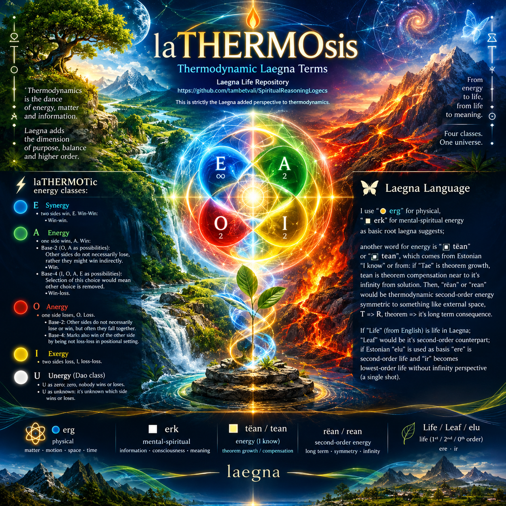

 

# 🔥 laTHERMOSis

Thermodynamic Laegna Terms.

[Laegna Life Repository](https://github.com/tambetvali/SpiritualReasoningLogecs) is the natural company of this thermodynamic repository.

This is strictly the Laegna added perspective to thermodynamics.

## ⚡ laTHERMOTic energy classes:

There are four energy classes in Laegna 🌡️:
- ##### 🔵 E Synergy;
  - two sides win, E. Win-Win:
    - **Win-win**.
- ##### 🟢 A Energy;
  - one side wins, A. Win:
    - ***Base-2*** (O, A as possibilities): Other sides do not necessarily lose, rather they might win indirectly.
      - **Win**
    - ***Base-4*** (I, O, A, E as possibilities):
      - Selection of this choice would mean other choice is removed.
      - **Win-loss**
- ##### 🔴 O Anergy:
  - one side loses, O. Loss.
    - Base-2: Other sides do not necessarily lose or win, but often they fall together.
    - Base-4: Marks also win of the other side by being not loss-loss in positional setting.
- ##### 🟡 I Exergy:
  - two sides loss, I, loss-loss.

There is also additional Dao class:
- ##### ⚪ U Unergy:
  - U as zero: zero, nobody wins or loses.
  - U as unknown: it's unknown which side wins or loses.

## 🦋 Laegna Language

I use "⚫ erg" for physical, "⬛ erk" for mental-spiritual energy as *basic root laegna suggests*;

another word for energy is "⬜ tëan" or "⬜ tean", which comes from Estonian "I know" or from: if "Tae" is theorem growth, tean is theorem compensation near to it's infinity from solution. Then, "rëan" or "rean" would be thermodynamic second-order energy symmetric to something like external space, T => R, theorem => it's long term consequence.

If "Life" (from English) is life in Laegna; "Leaf" would be it's second-order counterpart; if Estonian "elu" is used as basis "ere" is second-order life and "ir" becomes lowest-order life without infinity perspective (a single shot).
